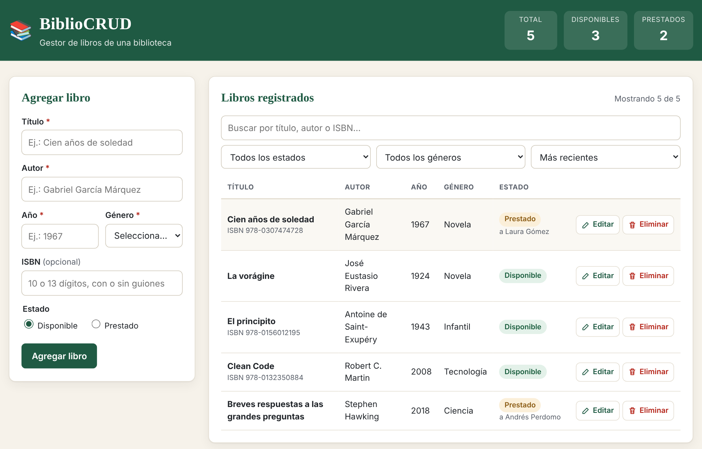
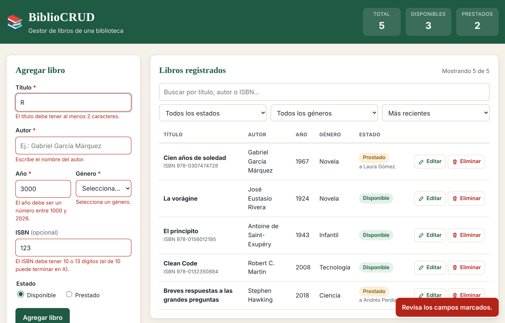
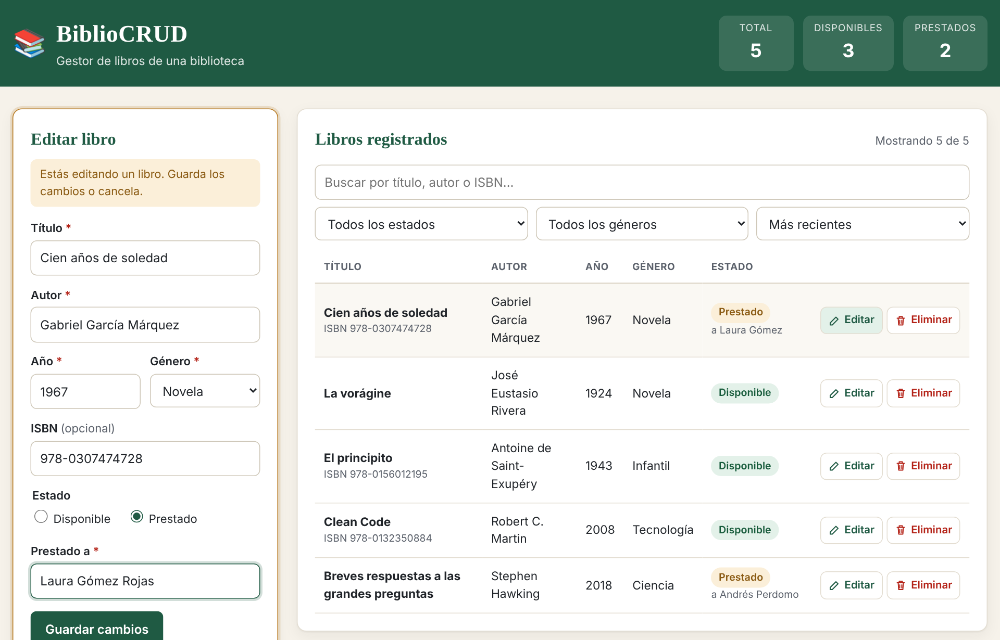
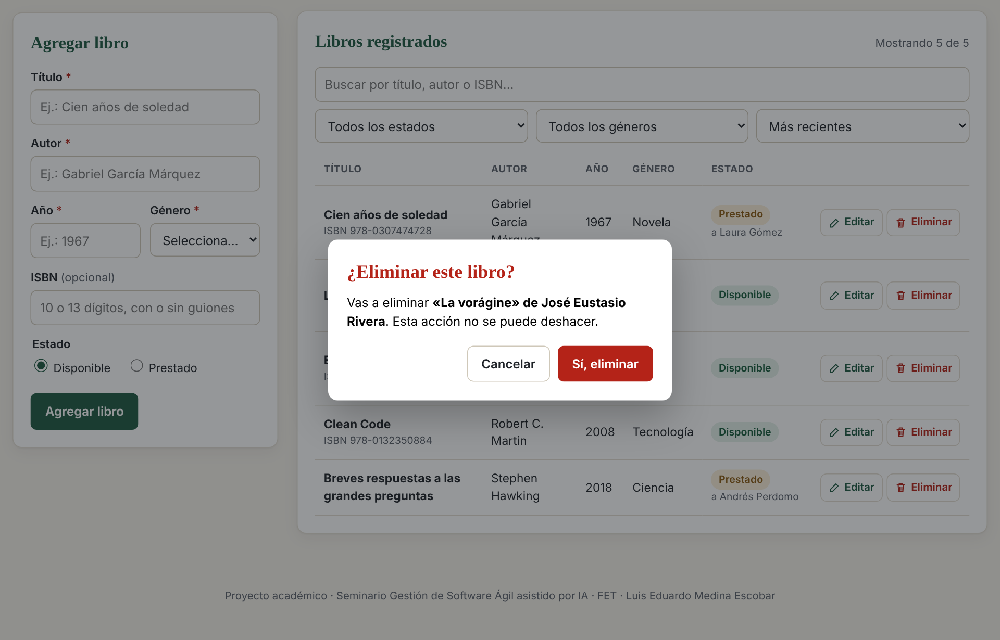
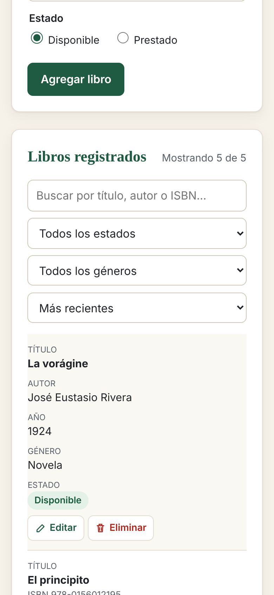

# 📚 BiblioCRUD: gestor de libros de una biblioteca

Aplicación web para **registrar, consultar, editar y eliminar libros** de una biblioteca pequeña. Funciona en el navegador sin servidor y guarda los datos en `localStorage`, así que los libros siguen ahí aunque se recargue la página.

Trabajo práctico del **Seminario Gestión de Software Ágil asistido por Inteligencia Artificial**, Fundación Escuela Tecnológica de Neiva “Jesús Oviedo Pérez” (FET). El desarrollo se guió con prompts a herramientas de IA (ver la sección [Prompts utilizados](#-prompts-utilizados)).

🎥 **Video explicativo:** [pega aquí el enlace del video]
🌐 **App en línea (GitHub Pages):https://luiseduardomedinaescobar-fet.github.io/seminario/

---

## ✨ Funcionalidades

| Acción CRUD | Qué hace en la app | Dónde está en el código |
|---|---|---|
| **Create** (crear) | El formulario “Agregar libro” valida los datos y guarda un libro nuevo con un id único. | `crearLibro()` en `js/almacen.js` |
| **Read** (leer) | La tabla lista los libros, con buscador (título, autor o ISBN, sin importar tildes), filtros por estado y género, y orden por fecha, título, autor o año. | `obtenerLibros()` en `js/almacen.js`, `filtrarYOrdenar()` en `js/app.js` y `renderizarLista()` en `js/interfaz.js` |
| **Update** (actualizar) | El botón **Editar** carga el libro en el formulario. Al guardar se reemplazan sus datos y se conserva su id. | `actualizarLibro()` en `js/almacen.js` |
| **Delete** (eliminar) | El botón **Eliminar** abre un cuadro de confirmación y, si se acepta, borra el libro. | `eliminarLibro()` en `js/almacen.js` |

Además:

- **Validaciones:**
  - título y autor son obligatorios;
  - el año debe estar entre 1000 y el año actual;
  - el género se elige de una lista;
  - el ISBN es opcional, pero si se escribe debe tener 10 o 13 dígitos;
  - si el libro está *Prestado*, hay que indicar a quién;
  - no se permite repetir el mismo título del mismo autor.
- **Resumen** en el encabezado con el total de libros, los disponibles y los prestados.
- **Mensajes** cortos que confirman cada acción.
- **Diseño adaptable**: en el celular la tabla se convierte en tarjetas.
- Botón **“Cargar libros de ejemplo”** para probar la app rápido.
- **Seguridad básica**: el texto que escribe el usuario se inserta con `textContent`, así que no se puede inyectar HTML.

## 🛠️ Tecnologías utilizadas

- **HTML5**: estructura de la página, formulario y diálogo nativo `<dialog>`.
- **CSS3**: variables de color, Grid, Flexbox y *media queries* para celular.
- **JavaScript (ES2020, sin librerías)**: lógica del CRUD organizada en módulos (patrón IIFE).
- **localStorage**: base de datos del navegador; los libros se guardan como JSON.
- **Herramientas de IA**: Claude (Anthropic) para generar la versión base, y [completar: la herramienta que uses en el video, por ejemplo GitHub Copilot o ChatGPT] para las mejoras.

## 📁 Estructura del proyecto

```
bibliocrud/
├── index.html          # Estructura de la página: encabezado, formulario, tabla y diálogo
├── css/
│   └── estilos.css     # Estilos; los colores se cambian en las variables de :root
├── js/
│   ├── almacen.js      # Capa de datos: las 4 operaciones CRUD sobre localStorage
│   ├── validacion.js   # Reglas que debe cumplir un libro antes de guardarse
│   ├── interfaz.js     # Todo lo visual: formulario, tabla, errores, mensajes y diálogo
│   └── app.js          # Punto de entrada: conecta los eventos con el CRUD
└── docs/capturas/      # Capturas de pantalla usadas en este README
```

Cada archivo tiene una sola responsabilidad. Solo `almacen.js` toca `localStorage`, solo `interfaz.js` modifica la pantalla y `app.js` coordina a los dos. Los scripts se cargan en ese orden al final de `index.html`.

## ▶️ Cómo ejecutar el proyecto

**Opción 1: sin instalar nada**

1. Descarga o clona el repositorio:
   ```bash
   git clone https://github.com/<tu-usuario>/bibliocrud.git
   ```
2. Abre el archivo `index.html` con doble clic. Funciona en Chrome, Edge o Firefox.

**Opción 2: con Visual Studio Code**

1. Abre la carpeta del proyecto en VS Code.
2. Instala la extensión **Live Server**.
3. Haz clic derecho sobre `index.html` y elige **Open with Live Server**.

**Opción 3: publicada en internet con GitHub Pages**

1. En el repositorio entra a **Settings → Pages**.
2. En *Source* elige **Deploy from a branch**, rama `main` y carpeta `/ (root)`.
3. Guarda. En uno o dos minutos la app queda disponible en `https://<tu-usuario>.github.io/bibliocrud/`.

> 💡 Para probar rápido, pulsa **“Cargar libros de ejemplo”** cuando la lista esté vacía.
> Para borrar todos los datos, abre las herramientas del navegador (F12) → *Application* → *Local Storage* y elimina la clave `bibliocrud.libros`.

## 🖼️ Capturas de pantalla

**Listado de libros (Read):** resumen arriba, buscador y filtros, y una tabla con acciones por libro.



**Validaciones al crear un libro (Create):** cada campo con problemas muestra su mensaje.



**Edición de un libro (Update):** el formulario cambia a “Editar libro” y se resalta.



**Confirmación antes de eliminar (Delete):**



**Vista en celular:**



## 🤖 Prompts utilizados

El proyecto se construyó por iteraciones: primero se generó una versión base completa y después se pidieron mejoras puntuales, revisando y probando cada cambio.

### Prompt 1: generar la aplicación base

- **Herramienta:** Claude (Anthropic), modelo Claude Opus 5.5, en claude.ai. Fecha: 20 de noviembre de 2026.
- **Texto exacto:** pegué el enunciado completo de este trabajo práctico y escribí:
  > bien ahora este
- **Aclaraciones:** la IA hizo tres preguntas antes de empezar y las respondí así:
  - autor: «Luis Eduardo Medina Escobar»;
  - tema del CRUD: «Biblioteca de libros»;
  - tecnología: «HTML + CSS + JS + localStorage».
- **Qué pedí y para qué:** una aplicación CRUD completa que cumpliera el enunciado, con código ordenado y comentado, para tener una primera versión funcional sobre la cual iterar.
- **Qué devolvió:**
  - la estructura de archivos;
  - el CRUD con validaciones, búsqueda, filtros y orden;
  - el diseño adaptable a celular;
  - un primer borrador de este README.

### Prompts de mejora (grabados en el video)

| # | Prompt | Qué pedí y para qué |
|---|---|---|
| 2 | *«Tengo una app CRUD de libros en HTML, CSS y JavaScript que guarda en localStorage. Los datos se leen con `Almacen.obtenerLibros()` en js/almacen.js. Agrega un botón "Exportar JSON" en la barra de herramientas del listado que descargue todos los libros en un archivo biblioteca.json. Dime en qué archivo va cada parte del código.»* | **Nueva funcionalidad.** Poder sacar una copia de los datos, porque `localStorage` solo existe en ese navegador. |
| 3 | *«Refactoriza la función filtrarYOrdenar de js/app.js separándola en dos funciones: una que filtre y otra que ordene. No cambies el comportamiento y explica por qué queda más fácil de mantener.»* | **Refactorización.** Que cada función haga una sola cosa, así es más fácil de leer, probar y modificar. |
| 4 | *«Quiero personalizar los colores de mi app. En css/estilos.css los colores están en variables dentro de :root. Propón una paleta con [colores elegidos por mí] que tenga buen contraste y dime qué variables cambiar.»* | **Personalización.** Darle a la app un estilo propio sin tocar la lógica. |
| 5 | *«Explícame con palabras sencillas, línea por línea, qué hace la función actualizarLibro de js/almacen.js y por qué se guarda la lista completa en localStorage.»* | **Comprensión del código.** Asegurarme de entender lo que entrego y poder explicarlo con mis palabras. |

## ✅ Casos de prueba

| Caso | Resultado esperado |
|---|---|
| Enviar el formulario vacío | Aparecen errores en título, autor, año y género, y no se guarda nada |
| Año 3000 o ISBN “123” | Mensaje de error en ese campo |
| Marcar *Prestado* sin nombre | Pide indicar a quién se prestó |
| Registrar el mismo título y autor dos veces | Avisa que ya existe (aunque cambien tildes o mayúsculas) |
| Editar un libro y guardar | La fila se actualiza y no se duplica |
| Eliminar y pulsar *Cancelar* | El libro sigue en la lista |
| Eliminar y confirmar | El libro desaparece |
| Recargar la página | Los datos siguen guardados |
| Buscar “garcia marquez” sin tilde | Encuentra *Cien años de soledad* |
| Escribir `` como título | Se muestra como texto y no se ejecuta |

## ⚖️ Uso responsable de la IA

- La IA generó la base y las mejoras. Yo revisé cada cambio, lo probé en el navegador y lo ajusté antes de guardarlo.
- Puedo explicar cada archivo:
  - `almacen.js` guarda y lee los datos;
  - `validacion.js` revisa las reglas;
  - `interfaz.js` pinta la pantalla;
  - `app.js` conecta los eventos.
- Los datos de ejemplo son inventados y no se usan datos personales reales.
- **Ajustes propios:** [completa aquí lo que cambiaste con tu criterio: colores, textos, nombre, reglas de validación, etc.].

## 👤 Autor

**Luis Eduardo Medina Escobar**
Programa de Ingeniería de Software, Fundación Escuela Tecnológica de Neiva “Jesús Oviedo Pérez” (FET)
luis_medinaes@fet.edu.co

Docente: Camilo Morales Vargas
